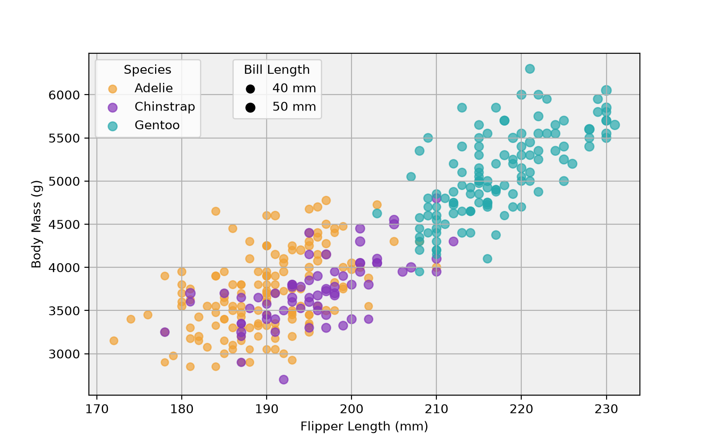
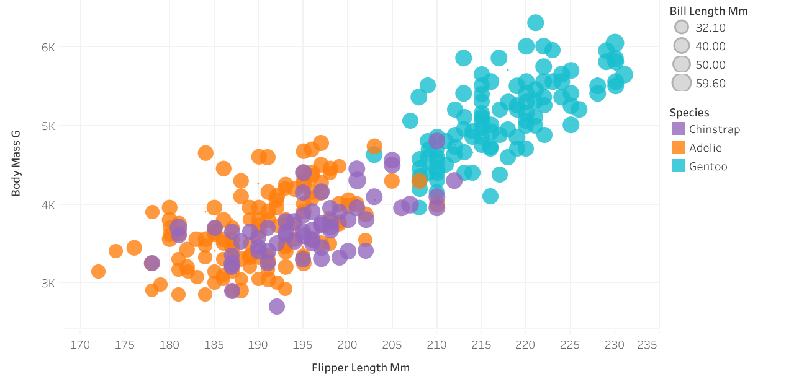
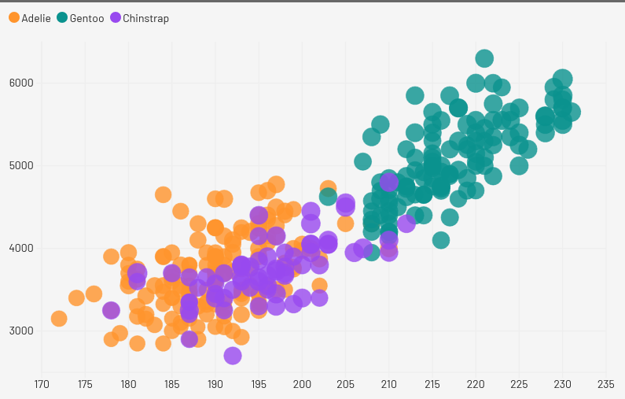

Assignment 2 - Data Visualization, 5 Ways  
===
# Default:<br>
<br>
This was the goal that I was attempting to recreate in different tools/libraries

# Python with Matplotlib:<br>
<br>
This was fairly easy for a library, although knowing pyhton or having experience definitely helps. I really struggled to get legends to work. Having two seperate legends required a handler. Also I fought with placment of the legends for a long time. I wanted them to be on the right and outside of the graph which seemed doable with "outer upper right" but there were two placement methods and the one that worked with my code did not allow for "outer". I also had to offset the second legend so they were readable. 
I set the size of the dots to be 1.1^(bill_length_mm) which made the change in size more distinct wile still being readable. For some reason this made the legends a bit weird where the Species legend ended up having diffent sized dots. I don't know what exactly the size is based on but I would assume it was the average size per species. Annoyingly the size legend didn't actually show that much of a difference. This is why I used exponential in the data drawing portion, but I was unable to appy that change to the legend. I think this is the most accurate except for my legend issues.<br>
Credit to<br>
-Benjamin Greenwood<br>
-VS Code Copilot<br>
-Griffon Munhall<br>

# Tableau:<br>
<br>
This was extremely easy. In total took me maybe 15 minutes. At first I found tableau public desktop to be a bit confulsing, but quickly learned that it worked by dragging data attributes onto graph attributes. For example dragging Species onto the color icon to get points to be colored by species. This was amazing and I would love to use it again in the future. Intrestingly I notices that there were more "bill_length_mm" than in the example and I do not know why exactly, but I think the overal outcome is the same.<br>
Version 2: I changed the colors and messed around with size to make the scaling more noticable. I had used "Edit in Shef" then 2*[Bill_length_mm] but then the legend was only showing the multiplied version, so I undid that. 

# D3 and JS:<br>
This was tourturous and evil. I struggled with this so badly. I heavily relied on using code from the D3 gallery which I edited to fit my needs. I like the freedom D3 gives but I have very little JS knowledge, and dislike how things wouldn't show up when I expected them to.<br>
Credit to:<br>
- https://d3-graph-gallery.com/graph/bubble_color.html <br>

# R and GGplot <br>
img+ words + cite 


# Fourish:<br>
<br>
This was simple like Tableau, which is expected as it is a tool and not a language. But I had many annoyances. Maybe using their built in AI could have helped me solve some of these but I am just going to list my user experience issues without the use of AI. I liked how you could load in data and it showed it as a table and also ass you assigned attributed the graph thumbnail changed in real time accordingly. On the other hand I struggled to change the colors from the presets to something more specific. I also couldn't make the size use a fancier function like [Bill_length_mm]^1.2 or x2.5, as it seemed to only allow an attribute to be assigned to a column. There wasn't an easy way to make a new column with an equation like excel where =D3x2.5 or something like that would automatically change the value based on another column's value. I also wasn't able to figure out how to add a second legend with size which is annoying.<br>
Version 2: I was able to figure out how to modify the colors to be more accurate.


- Write a paragraph for each visualization tool you use. What was easy? Difficult? Where could you see the tool being useful in the future? Did you have to use any hacks or data manipulation to get the right chart?
- Note: name your pull request using the following scheme: 
```
a2-your Gh username-your first name-your lastname
```

## Technical Achievements
- **Proved P=NP**: Using a combination of...
- **Solved AI Forever**: ...

### Design Achievements
- **Re-vamped Apple's Design Philosophy**: As demonstrated in my colorscheme...
